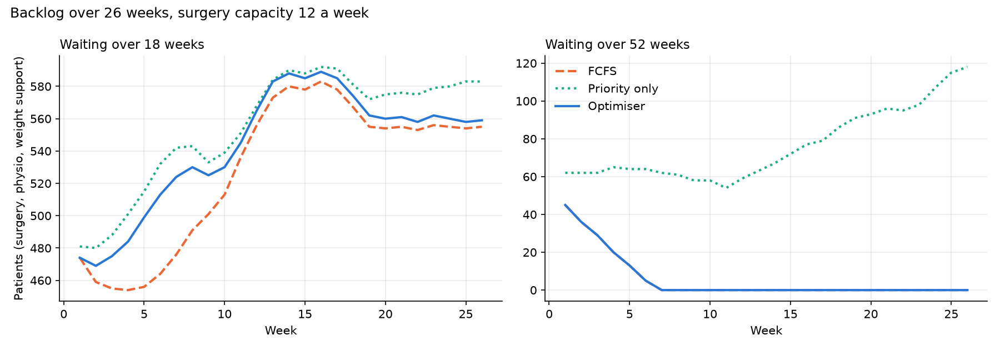
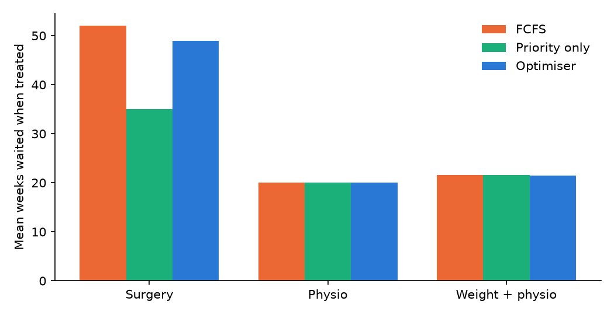
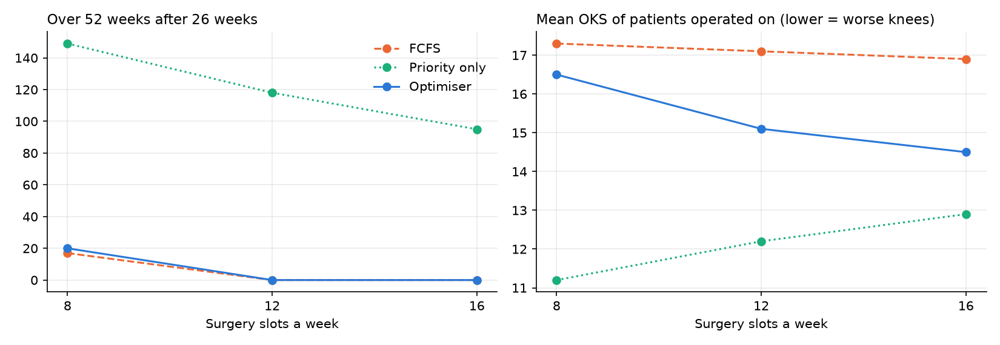

# Weekly slots: 26-week simulation

Start: the cleaned waiting list, 1040 patients needing a slot (surgery 783, physio 189, weight support and physio 68); 75 already over 52 weeks. New referrals: 26.3 a week (Poisson; the rate implied by the generator's referral dates), 638 in 26 weeks, same for every policy. Slots a week: surgery 12, physio 20, weight support 8. Counts are of patients who need one of these slots.

**Skipped** = an over-52 patient left without a slot while a slot they could use went to someone not over 52. **Weeks over-52s didn't fit** = weeks the optimiser reported infeasible (it then gave every slot it could to over-52s; the rest were listed, not skipped).

## Surgery capacity 12

|                            |   FCFS |   Priority only |   Optimiser |
|:---------------------------|-------:|----------------:|------------:|
| Over 18 weeks, end         |  555   |           583   |       559   |
| Over 52 weeks, end         |    0   |           118   |         0   |
| Over 52, weekly mean       |    5.7 |            76.5 |         5.7 |
| Over-52 patients skipped   |    0   |           181   |         0   |
| Weeks over-52s didn't fit  |    0   |             0   |         6   |
| Mean wait, surgery         |   52   |            35   |        48.9 |
| Mean wait, physio          |   20   |            20   |        20   |
| Mean wait, weight + physio |   21.6 |            21.6 |        21.5 |
| Mean OKS operated on       |   17.1 |            12.2 |        15.1 |
| Treated                    |  675   |           675   |       675   |

In the over-52 panel FCFS and the optimiser are the same line: both clear the over-52s by week 7 and keep the count at zero (FCFS by always taking the longest wait, the optimiser by its hard rule).

## Sensitivity: surgery capacity 8, 12, 16 a week

|   Surgery slots | Policy        |   Over 52, end |   Over 52, weekly mean |   Over 18, end |   Over-52s skipped |   Weeks infeasible |   Mean wait, surgery |   Mean OKS operated on |
|----------------:|:--------------|---------------:|-----------------------:|---------------:|-------------------:|-------------------:|---------------------:|-----------------------:|
|               8 | FCFS          |             17 |                   12.8 |            659 |                  0 |                  0 |                 59.3 |                   17.3 |
|               8 | Priority only |            149 |                   87.7 |            668 |                198 |                  0 |                 37.6 |                   11.2 |
|               8 | Optimiser     |             20 |                   14.5 |            659 |                  0 |                 22 |                 58.9 |                   16.5 |
|              12 | FCFS          |              0 |                    5.7 |            555 |                  0 |                  0 |                 52   |                   17.1 |
|              12 | Priority only |            118 |                   76.5 |            583 |                181 |                  0 |                 35   |                   12.2 |
|              12 | Optimiser     |              0 |                    5.7 |            559 |                  0 |                  6 |                 48.9 |                   15.1 |
|              16 | FCFS          |              0 |                    3.5 |            451 |                  0 |                  0 |                 46.9 |                   16.9 |
|              16 | Priority only |             95 |                   66.3 |            493 |                163 |                  0 |                 33.7 |                   12.9 |
|              16 | Optimiser     |              0 |                    3.5 |            474 |                  0 |                  4 |                 41.9 |                   14.5 |

## Triage on vs off (20 arrival seeds, mean ± 95% CI)

Triage off: every referral with KL 2 or more goes on the surgery list (1400 of 1500 patients at the start, against 783 with triage on), so no physio-first or weight-support redirect. Both scenarios use the optimiser and the same arrivals. Over 18/52 counts are of patients waiting for a slot.

|                                            | Triage on (optimiser)   | Triage off (optimiser)   |
|:-------------------------------------------|:------------------------|:-------------------------|
| Surgery list, start                        | 783 ± 0                 | 1400 ± 0                 |
| Surgery list, end                          | 829 ± 10                | 1730 ± 13                |
| Mean wait at surgery (weeks)               | 48.4 ± 0.1              | 59.5 ± 0.0               |
| Over 18 weeks, end                         | 574 ± 4                 | 1258 ± 6                 |
| Over 52 weeks, end                         | 0.0 ± 0.0               | 97.0 ± 0.0               |
| Weeks over-52s didn't fit                  | 7.8 ± 0.3               | 26.0 ± 0.0               |
| Mean OKS operated on (lower = worse knees) | 15.0 ± 0.0              | 18.5 ± 0.0               |

## Robustness: 20 arrival seeds (2026-2045), surgery capacity 12

Each value is the mean ± half-width of the 95% CI across seeds (t distribution). Only the arrivals change between seeds; the starting list is the same. A new referral can't pass 52 weeks within 26 weeks, so the over-52 figures depend only on the starting list: their CI is 0 by construction, not by luck.

|                                            | FCFS       | Priority only   | Optimiser   |
|:-------------------------------------------|:-----------|:----------------|:------------|
| Surgery list, end                          | 829 ± 10   | 829 ± 10        | 829 ± 10    |
| Over 18 weeks, end                         | 564 ± 4    | 599 ± 5         | 574 ± 4     |
| Over 52 weeks, end                         | 0.0 ± 0.0  | 122 ± 1         | 0.0 ± 0.0   |
| Over 52 weeks, weekly mean                 | 5.7 ± 0.0  | 77.7 ± 0.3      | 5.8 ± 0.0   |
| Over-52s skipped                           | 0.0 ± 0.0  | 182 ± 0         | 0.0 ± 0.0   |
| Weeks over-52s didn't fit                  | 0.0 ± 0.0  | 0.0 ± 0.0       | 7.8 ± 0.3   |
| Mean wait at surgery (weeks)               | 52.0 ± 0.0 | 34.0 ± 0.3      | 48.4 ± 0.1  |
| Mean OKS operated on (lower = worse knees) | 17.1 ± 0.0 | 12.1 ± 0.1      | 15.0 ± 0.0  |

### Do the differences hold across seeds?

Paired by seed (same arrivals). A difference holds when its 95% CI excludes 0; the count says in how many seeds it went the same way.

| comparison                        | metric                                     | difference   | verdict                                     |
|:----------------------------------|:-------------------------------------------|:-------------|:--------------------------------------------|
| Optimiser - FCFS                  | Surgery list, end                          | 0.0 ± 0.0    | same in every seed                          |
| Optimiser - FCFS                  | Over 18 weeks, end                         | 9.0 ± 1.2    | holds: higher in 20/20 seeds                |
| Optimiser - FCFS                  | Over 52 weeks, end                         | 0.0 ± 0.0    | same in every seed                          |
| Optimiser - FCFS                  | Over 52 weeks, weekly mean                 | 0.1 ± 0.0    | holds: higher in 18/20 seeds, CI excludes 0 |
| Optimiser - FCFS                  | Over-52s skipped                           | 0.0 ± 0.0    | same in every seed                          |
| Optimiser - FCFS                  | Weeks over-52s didn't fit                  | 7.8 ± 0.3    | holds: higher in 20/20 seeds                |
| Optimiser - FCFS                  | Mean wait at surgery (weeks)               | -3.6 ± 0.1   | holds: lower in 20/20 seeds                 |
| Optimiser - FCFS                  | Mean OKS operated on (lower = worse knees) | -2.1 ± 0.0   | holds: lower in 20/20 seeds                 |
| Optimiser - Priority only         | Surgery list, end                          | 0.0 ± 0.0    | same in every seed                          |
| Optimiser - Priority only         | Over 18 weeks, end                         | -25.5 ± 1.9  | holds: lower in 20/20 seeds                 |
| Optimiser - Priority only         | Over 52 weeks, end                         | -122 ± 1     | holds: lower in 20/20 seeds                 |
| Optimiser - Priority only         | Over 52 weeks, weekly mean                 | -71.9 ± 0.3  | holds: lower in 20/20 seeds                 |
| Optimiser - Priority only         | Over-52s skipped                           | -182 ± 0     | holds: lower in 20/20 seeds                 |
| Optimiser - Priority only         | Weeks over-52s didn't fit                  | 7.8 ± 0.3    | holds: higher in 20/20 seeds                |
| Optimiser - Priority only         | Mean wait at surgery (weeks)               | 14.4 ± 0.2   | holds: higher in 20/20 seeds                |
| Optimiser - Priority only         | Mean OKS operated on (lower = worse knees) | 3.0 ± 0.0    | holds: higher in 20/20 seeds                |
| Optimiser, triage off - Optimiser | Surgery list, end                          | 900 ± 7      | holds: higher in 20/20 seeds                |
| Optimiser, triage off - Optimiser | Over 18 weeks, end                         | 685 ± 3      | holds: higher in 20/20 seeds                |
| Optimiser, triage off - Optimiser | Over 52 weeks, end                         | 97.0 ± 0.0   | holds: higher in 20/20 seeds                |
| Optimiser, triage off - Optimiser | Over 52 weeks, weekly mean                 | 44.1 ± 0.0   | holds: higher in 20/20 seeds                |
| Optimiser, triage off - Optimiser | Over-52s skipped                           | 0.0 ± 0.0    | same in every seed                          |
| Optimiser, triage off - Optimiser | Weeks over-52s didn't fit                  | 18.2 ± 0.3   | holds: higher in 20/20 seeds                |
| Optimiser, triage off - Optimiser | Mean wait at surgery (weeks)               | 11.1 ± 0.1   | holds: higher in 20/20 seeds                |
| Optimiser, triage off - Optimiser | Mean OKS operated on (lower = worse knees) | 3.5 ± 0.0    | holds: higher in 20/20 seeds                |
